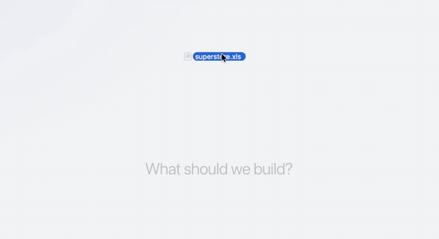
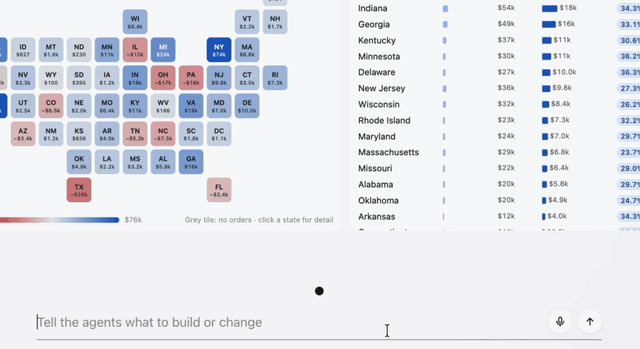
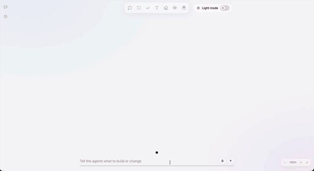
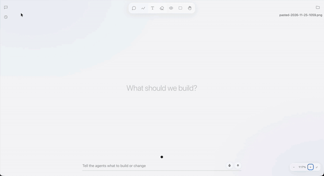
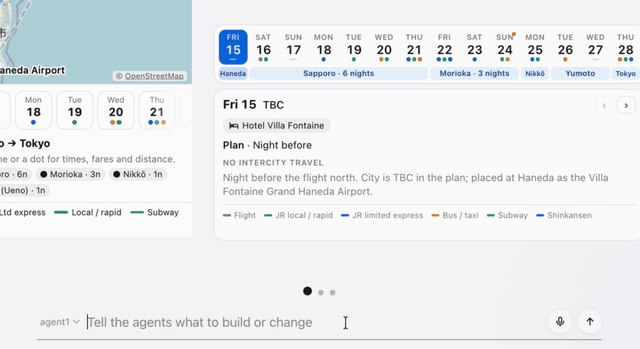

# Chalky

Most AI tools only let you talk to the agent in words. In Chalky you can also point, draw, sketch or drop in files,
and the agents answer the same way, with notes and drawings on the page.

Ask for a team when a job needs one, and the agents work side by side. Every app they build is agentic by default.
And Chalky can change itself: its interface and tools are files the agents can edit.

Chalky is built on [pi](https://github.com/earendil-works/pi).

<!-- demo.gif -->

## What you can do

<table>
<tr>
<td width="50%" valign="top">
<b>Use your own files, leave notes</b><br>
Drop spreadsheets, PDFs, Word or PowerPoint files on the page. Click anything and write a note.<br><br>

</td>
<td width="50%" valign="top">
<b>Draw on the page</b><br>
Circle, sketch, scribble, then send. Mark up as many things as you like at once.<br><br>

</td>
</tr>
<tr>
<td width="50%" valign="top">
<b>Ask about what you see</b><br>
The answer is drawn on the page.<br><br>

</td>
<td width="50%" valign="top">
<b>Go back any time</b><br>
Every version is kept, one click away.<br><br>

</td>
</tr>
<tr>
<td width="50%" valign="top">
<b>Change Chalky itself</b><br>
The page and its tools are files the agents can edit.<br><br>

</td>
<td width="50%" valign="top">
<b>Lay out bigger builds</b><br>
Draw a frame for each part. An agent works on each one at the same time.<br><br>

</td>
</tr>
<tr>
<td width="50%" valign="top">
<b>Let it check its own work</b><br>
The agent tries the app itself, and can ask to see your screen.<br><br>

</td>
<td width="50%" valign="top">
<b>Connect MCP servers</b><br>
Choose which of their tools the agents can use. See <a href="#mcp-servers">MCP servers</a>.
</td>
</tr>
</table>

## Install

### 1. Install Node.js

You need Node.js 22.19 or newer. Check what you have:

```sh
node --version
```

If it's missing or older, install the current LTS from [nodejs.org](https://nodejs.org), or:

```sh
# macOS
brew install node

# Windows (PowerShell)
winget install OpenJS.NodeJS.LTS

# Linux, WSL or macOS with nvm
nvm install --lts
```

On Windows, open a new terminal after installing so `node` and `npm` are found.

### 2. Install Chalky

```sh
npm install -g @chalky/chalky
```

On macOS or Linux, if npm says it has no permission to write to its global folder, use nvm (it installs global
packages in your home folder) rather than running npm with `sudo`.

### 3. Start it

```sh
chalky
```

Open [http://127.0.0.1:3000](http://127.0.0.1:3000) in your browser. To stop it, press Ctrl+C in the terminal.

### 4. Pick a model

Type `/login` in the page's message box. You can:

- **sign in with an account you already have**: ChatGPT, Claude, GitHub Copilot and others. Chalky opens the
  provider's page and you approve it there;
- **or add an endpoint with an API key**. Local models work too.

Then type `/model` to choose which model the agents use. You can give each agent its own.

## Commands

Type these in the page's message box.

| Command | What it does |
|---|---|
| `/login`, `/logout` | Sign in to a model provider, or add an endpoint with an API key |
| `/model` | Choose the model, for all agents or one |
| `/mcp` | Turn MCP servers, and each of their tools, on or off |
| `/new` | Start a new conversation with the agent |
| `/compact` | Shorten the conversation so far, to free up context |
| `/thinking` | Set how hard the agent thinks: off, minimal, low, medium or high |

## Your files

Chalky keeps its files in `~/.chalky` (`%USERPROFILE%\.chalky` on Windows). To use another folder, set
`CHALKY_HOME`.

| Folder | What's in it |
|---|---|
| `agent/` | What the agents are: their instructions, the page, its tools, your logins and `mcp.json` |
| `built/` | What they made for you: cards, boards and apps |
| `data/` | Conversations, the data your apps saved, notes, screenshots |
| `workspace/` | The agents' working folder. Files you drop on the page go in `workspace/drops/` |

The version history covers `agent/` and `built/` together, so one rollback puts back both what the agents made and
any changes they made to Chalky. Logins and API keys are not part of it.

## If the page breaks

The agents can edit the page itself, so a bad edit can break it. Open
[http://127.0.0.1:3000/recover](http://127.0.0.1:3000/recover) for a list of saved versions, newest first, and go
back to one that worked.

## Update

```sh
npm update -g @chalky/chalky
```

Then restart `chalky`. Each release is merged with what your agents changed. Where both changed the same lines,
your version is kept, the release's is saved next to it as `<file>.new`, and the main agent is asked to combine
the two. An update can be undone in the version panel like any other change.

## Uninstall

```sh
npm uninstall -g @chalky/chalky
```

Then delete the `.chalky` folder in your home folder. This also deletes everything you built, your logins and your
history.

## MCP servers

Chalky's agents can use tools from [MCP](https://modelcontextprotocol.io) servers. Add them to
`~/.chalky/agent/mcp.json`, restart `chalky`, then type `/mcp` to choose which servers and tools the agents may
use. You can also ask the agent to add a server for you.

For example, to give the agents web search with [Tavily](https://tavily.com):

```json
{
  "mcpServers": {
    "tavily": {
      "command": "npx",
      "args": ["-y", "tavily-mcp@latest"],
      "env": { "TAVILY_API_KEY": "${TAVILY_API_KEY}" },
      "description": "Search the web and read pages"
    }
  }
}
```

## Settings

Set these in the environment before starting `chalky`. All are optional.

| Variable | Default | What it does |
|---|---|---|
| `PORT` | `3000` | The page's port |
| `CHALKY_HOME` | `~/.chalky` | Where Chalky keeps its files |
| `MAX_STEPS` | `30` | Most model calls an agent makes for one message before it stops |
| `TEAM_MAX_AGENTS` | `8` | Most agents working at once |
| `HISTORY_KEEP_DAYS` | `7` | How long undo and redo steps are kept |
| `STT_BASE_URL`, `STT_API_KEY`, `STT_MODEL` | browser's own | An OpenAI-compatible speech-to-text endpoint for the microphone (`STT_MODEL` defaults to `whisper-1`) |

## Run from source

```sh
git clone https://github.com/weihanfeng/pi-chalky.git
cd pi-chalky
npm install
node server.ts
```

Run this way, Chalky keeps its files in the cloned folder instead of `~/.chalky`.

## Feedback

Chalky is early. If something breaks, confuses you, or you wish it did something it doesn't, please
[open an issue](https://github.com/weihanfeng/pi-chalky/issues). Screenshots help a lot.

## License

MIT. Built on [pi](https://www.npmjs.com/package/@earendil-works/pi-coding-agent).
